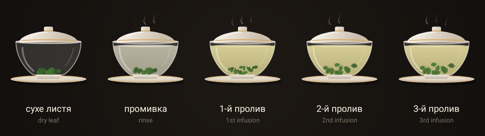
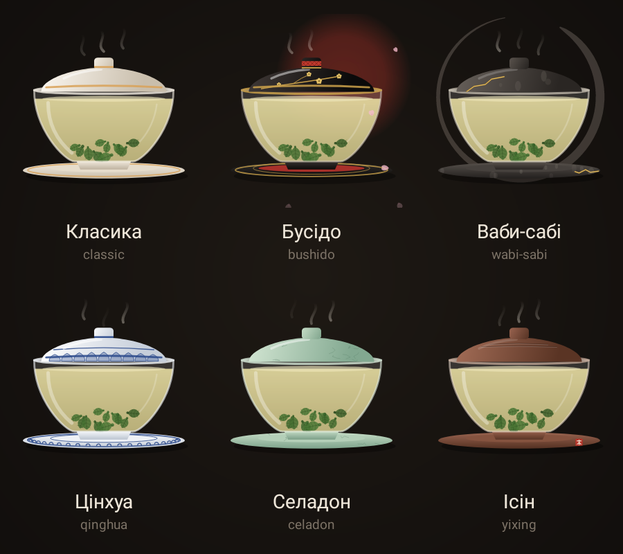
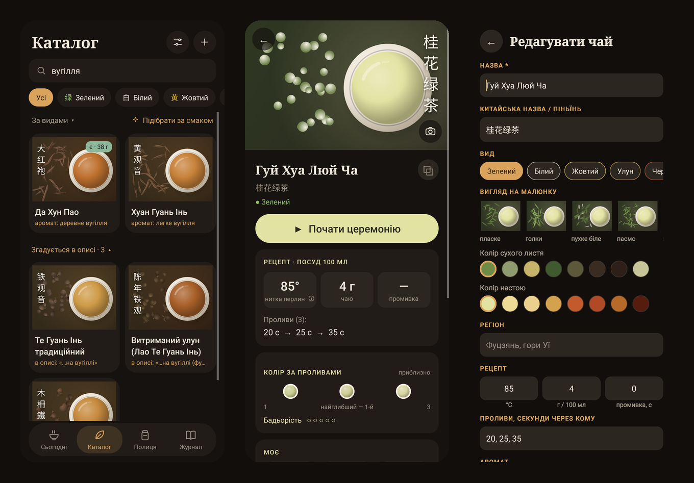
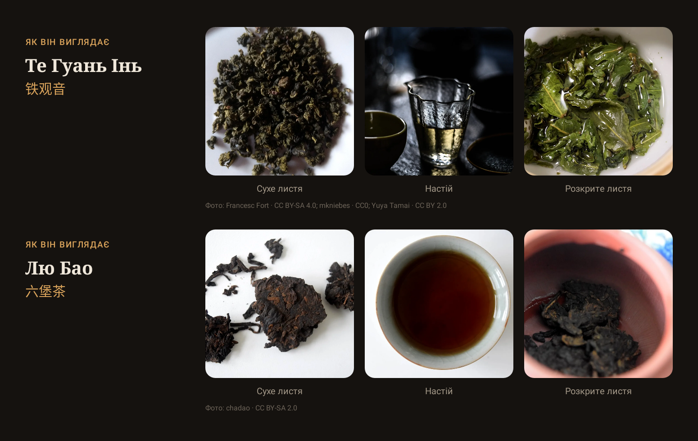
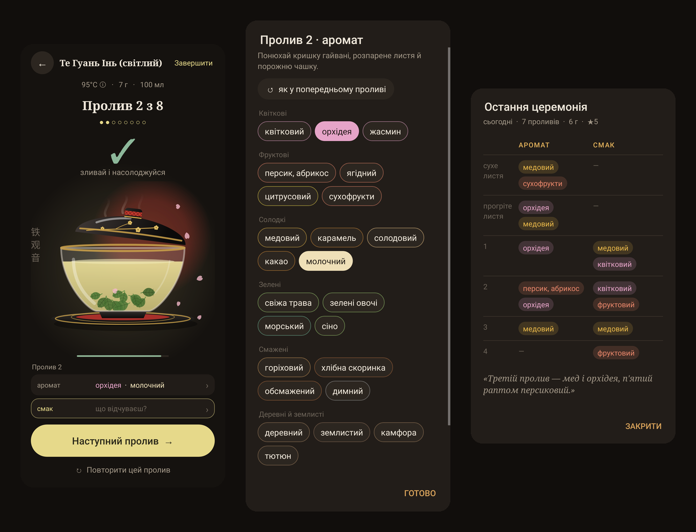
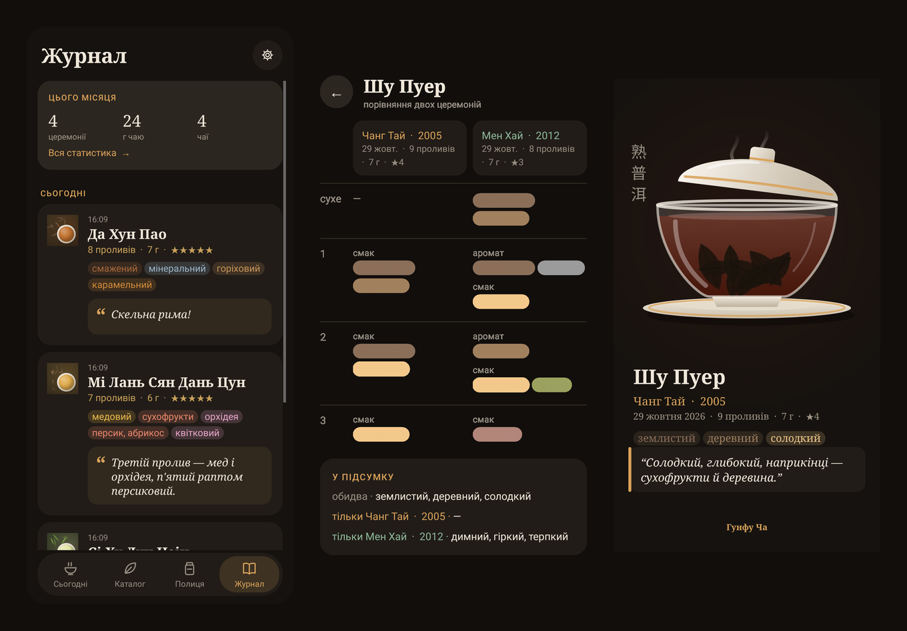
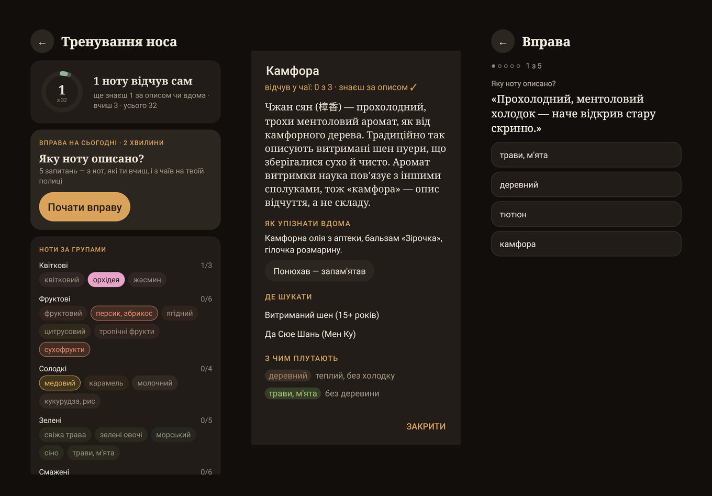
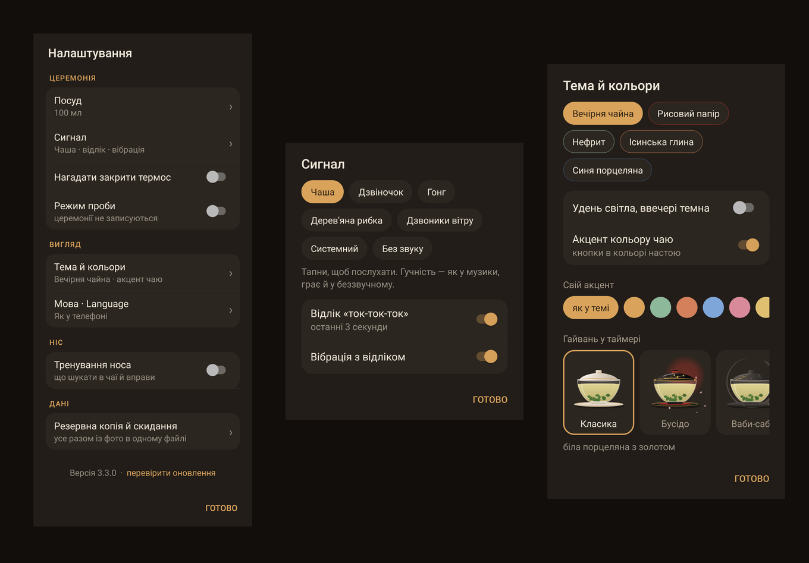

  

  <a href="https://github.com/golftennis3/gongfu-cha-releases/releases/latest"><b>⬇ Завантажити останню версію</b></a>
  &nbsp;·&nbsp;
  <a href="#english">English</a>

---

**Гунфу Ча** — тиха програма для китайської чайної церемонії 功夫茶. Вона веде тебе від першого проливу до останнього, підказує рецепт для кожного чаю і запам'ятовує, що ти відчував. Ніякої реклами, акаунтів чи зайвого шуму.

## Що нового в 3.5

Біля гайвані тепер живе чайна фігурка (茶宠): Цзінь Чань, Піксю, ченчик, Мілефо, порося, черепаха, рибка-хамелеон або хлопчик. Коли зливаєш промивку і коли завершуєш церемонію, на неї стікає цівка чаю, а з кожною церемонією глина повільно вбирає чай: темніє, береться блиском і набуває кольору твоїх чаїв, як справжня ісинська. Рибка червоніє від окропу, а хлопчик пускає цівку. Усі зміни описані на [сторінці версії](https://github.com/golftennis3/gongfu-cha-releases/releases/latest).

## Таймер-гайвань

Замість цифр — гайвань, яка повільно наповнюється настоєм: листя розкривається, з'являється пара, кришка піднімається, коли час зливати. Для кожного проливу свій час із рецепта. Між проливами — коротка пауза на три вдихи. Коли настій готовий, лунає звук: співоча чаша, дзвіночок, гонг, дерев'яна рибка або дзвоники вітру.

За три секунди до сигналу звучить тихе «ток-ток-ток» і, якщо хочеш, легка вібрація: встигаєш узяти гайвань. Поки чай настоюється, відлік видно й у шторці сповіщень та на заблокованому екрані, з кнопкою «Злити». Можна ввімкнути маленьке нагадування закрити термос, коли заливаєш воду.

Скручені в кульки чаї — Те Гуань Інь, гаошань, Дун Дін, жасминові перлини — розкриваються поступово, як насправді: після промивки кульки лише набухають, а до третього проливу листя розправляється повністю.

### Гайвань під настрій

Класика з білої порцеляни із золотом, Бусідо з чорного лаку з золотою гілкою сакури, Ваби-сабі з сірого раку з тріщиною кінцуґі, синьо-біла Цінхуа, нефритовий Селадон і пурпурова ісинська глина. Вибрати можна в налаштуваннях («Тема й кольори») або просто під час церемонії — довгим натисканням на гайвань.

## 149 чаїв

Зелені, білі, жовті, улуни, червоні, пуери з різних гір, темні чаї, а також Японія, Корея, Індія, Непал. Для кожного:
- рецепт для гунфу: температура, грами на об'єм, час кожного проливу;
- аромат, смак і традиційно описаний ефект;
- ієрогліфи, піньїнь, регіон і що означає назва («Великий червоний халат», «Залізна богиня милосердя»).

Сторінка чаю читається згори донизу: «Почати церемонію» з рецептом, далі «Про чай» — опис, фото, колір настою за проливами, аромат, смак і ефект, потім «Моє» — твоя оцінка, нотатки, запас і що ти в цьому чаї знаходиш. Незрозумілі слова в описах (хуей гань, ча ці, янь юнь, окислення…) підкреслені: натисни — і з'явиться пояснення.

Можна додати власний чай і самому обрати, як він виглядає: форму листя (голки, кульки, перлини, пласке, золоті бруньки, млинець, цеглина, мандарин…), колір сухого листя й колір настою. Змінити це можна й потім.

## Пошук

Шукай так, як говориш: «османтус», «мед», «копчений», «вугілля». Пошук розуміє синоніми й різні форми слова, пробачає одну помилку і показує, чому чай знайшовся: збіг у назві, у нотах чи в описі. Чаї, де слово лише згадується в описі, зібрані окремо внизу, щоб не заважати.

## Справжні фото

На сторінці чаю — блок «Як він виглядає»: сухе листя, настій у чашці й розкрите листя після заварювання. Фото поступово додаються в цьому репозиторії (`photos/`) і приходять у програму самі, без оновлення. Автор і ліцензія кожного фото — під ним і в [photos/README.md](photos/README.md).

Можна поставити й свої фото — вони лишаються тільки на твоєму телефоні.

## Аромат і смак

- Аромат записується в три моменти: **сухе листя**, **прогріте листя** в гарячому гайвані й **заварене** після кожного проливу. Смак — після кожного проливу.
- Для аромату свій, тонший набір нот (орхідея, персик, солод, камфора, мокрий камінь…), розкладений за групами, — бо язик розрізняє лише кілька смаків, а ніс сотні нот. Довге натискання на ноту пояснює її.
- Рекомендації «що спробувати далі» за твоїм смаком і схожі чаї на сторінці кожного чаю.
- Полиця з запасом у грамах (списується після церемонії) і список «Хочу спробувати».

## Журнал

- Журнал зібраний по днях: чай, проливи, оцінка, ноти й нотатка. Кожна церемонія відкривається таблицею — аромат і смак по проливах.
- **Порівняння**: дві церемонії одного чаю поруч, пролив за проливом, і підсумок — що відчув обидва рази, а що лише одного.
- **Картка церемонії**: гарна картинка з чаєм, нотами й нотаткою, щоб надіслати другові.
- Статистика за місяць, рік або весь час: скільки церемоній і грамів чаю, улюблені види, аромати й смаки, коли ти п'єш чай.

## Тренування носа

Необов'язкове тренування, щоб розрізняти ноти впевнено. Без нагадувань і серій — коли захочеш.
- 32 ноти за групами. Нота вважається твоєю, коли ти тричі відчув її сам у чаї, де вона є в описі.
- Для кожної ноти: як її описують, як упізнати вдома (камфорна олія, кориця, мед…), у яких чаях шукати і з чим її плутають.
- Перед церемонією — тихий рядок «Зазвичай шукають: …», після — що з твоїх нот збіглося з описом.
- Вправа на 2 хвилини: «Яку ноту описано?», з нот, які ти вчиш, і з чаїв на твоїй полиці.

Вмикається в налаштуваннях («Ніс»).

## Чайний посуд

Довідник: гайвань, ісинська глина, нісін, цзяньшуй, чаочжоу, порцеляна, скло і кюсу — що це, як кожен змінює смак, для яких чаїв і як доглядати.

## Теми

Вечірня чайна, Рисовий папір, Нефрит, Ісинська глина, Синя порцеляна — або свій колір акценту. Можна ввімкнути «акцент — колір чаю»: сторінка кожного чаю набуває кольору його настою. І автоматичне перемикання: світла тема вдень, темна ввечері.

## Налаштування

Короткий список: посуд, сигнал, термос, режим проби, тема, мова, тренування носа і резервна копія. У кожному рядку видно, що зараз обрано, а деталі відкриваються тапом.

## І ще

- **Приказка дня** — справжні рядки про чай від Лу Юя, Лу Туна, Су Ші, чаньських майстрів, з ієрогліфами, читанням і джерелом.
- **Вода без термометра** — як на око визначити потрібну температуру за бульбашками.
- **Де купити** — пропозиції в наявності з Prom.ua, відсортовані за ціною за 100 г, і спеціалізовані українські чайні магазини.
- **Українська та англійська** — мову можна змінити в будь-який момент.
- **Режим проби** — заварити, нічого не записуючи.
- **Резервна копія** — полиця, нотатки, журнал, свої чаї, налаштування й усі фото в одному файлі. Відновлюються й старі копії.

## Встановлення

1. Відкрий [останню версію](https://github.com/golftennis3/gongfu-cha-releases/releases/latest) з телефона й завантаж файл **GongfuCha-….apk**.
2. Відкрий його. Android попередить, що програма не з Google Play, — дозволь встановлення з цього джерела.
3. Готово. Далі **оновлення приходять самі**: коли виходить нова версія, у програмі з'явиться тихий рядок «Доступна версія…», одне натискання — і вона встановиться поверх, зі збереженням усіх даних. Перевірити вручну — «перевірити оновлення» внизу налаштувань (⚙ на екрані «Сьогодні»).

Потрібен Android 8.0 або новіший.

## Приватність

Усе зберігається тільки на твоєму телефоні: жодних акаунтів, аналітики чи реклами. Твої власні фото теж нікуди не завантажуються, а картка церемонії йде лише туди, куди ти сам її надішлеш. В інтернет програма звертається лише тоді, коли ти відкриваєш «Де купити» (пошук на Prom.ua), і щоб узяти з цього репозиторію на GitHub нову версію та фото чаїв.

Описи ефектів — традиційні враження чаювальників, а не медичні поради.

---

## English

**Gongfu Cha** is a quiet app for the Chinese tea ceremony 功夫茶. It guides you from the first infusion to the last, gives a recipe for every tea and remembers what you tasted. No ads, no accounts, no noise.

- **Gaiwan timer.** Instead of numbers, a gaiwan slowly fills with tea: the leaves unfurl, steam rises and the lid lifts when it's time to pour. Ball-rolled oolongs and jasmine pearls open gradually, fully by the third infusion. Each infusion has its own time; between infusions, a short pause for three breaths. A singing bowl, bell, gong, wooden fish or wind chimes tells you when it's ready.
- **Six gaiwan styles** — classic porcelain, bushido black lacquer, wabi-sabi raku with kintsugi, qinghua blue-and-white, celadon and Yixing clay; long-press the gaiwan to switch.
- **Countdown** — a soft tap-tap-tap (and an optional buzz) in the last three seconds, the countdown in the notification shade and on the lock screen with a “Pour” button, and an optional reminder to close the thermos.
- **149 teas** — green, white, yellow, oolong, red, pu-erh from different mountains, dark teas, plus Japan, Korea, India and Nepal. Each with a gongfu recipe (temperature, grams, every infusion's time), aroma, taste, traditional effect, hanzi and pinyin. Add your own teas and choose how they look: leaf shape, dry leaf colour and liquor colour.
- **Real photos** — “How it looks” on the tea page: dry leaf, liquor and spent leaves. Photos are added to this repository over time and reach the app by themselves; each shows its author and licence ([photos/README.md](photos/README.md)). Your own photos stay on your phone.
- **Search** that understands synonyms, word forms and one typo, and says why a tea matched: its name, its notes or its description.
- **Aroma and taste.** Note the aroma of the dry leaf, the warmed leaf and each infusion, and the taste of each infusion, from notes laid out in families. Recommendations, similar teas, a shelf with stock in grams and a wishlist.
- **Journal** grouped by day, each ceremony as a table by infusion. Compare two ceremonies of the same tea side by side, share a ceremony as a picture, see your stats by month, year or all time.
- **Nose training** (optional): 32 notes, how to recognise each at home, which teas to look in, what it gets confused with; a quiet “usually found” line before a ceremony, what matched after it, and a two-minute exercise. No reminders, no streaks.
- **Glossary.** Terms in the descriptions (hui gan, cha qi, yan yun, oxidation…) are underlined and explained on a tap; a long press explains any note.
- **Teaware guide** — gaiwan, Yixing, Nixing, Jianshui, Chaozhou, porcelain, glass and kyusu: how each shapes the taste, which teas suit it, how to care for it.
- **Saying of the day** — real lines about tea, with the hanzi, the reading and the source.
- **Water without a thermometer**, **where to buy** (in-stock offers from Ukrainian shops, by price per 100 g), **Ukrainian and English**, **practice mode**, and **backup** of everything, photos included, in one file.
- **Calm settings** in four short groups: Ceremony, Look, Nose, Data.
- **New in 3.4:** your own recipe for any catalogue tea (water, leaf, rinse), a second rinse, pressed teas that come apart in the gaiwan little by little, search that understands Russian spellings and pinyin tone marks, and 24 more sayings.
- **New in 3.5: a tea pet** on the tray beside the gaiwan — the rinse and the last of the tea are poured over it, and ceremony by ceremony its clay darkens, shines and takes the colour of your teas, like real Yixing clay.

**Install:** open the [latest release](https://github.com/golftennis3/gongfu-cha-releases/releases/latest) on your phone, download **GongfuCha-….apk**, open it and allow installing from this source. After that, updates arrive inside the app; to check by hand, tap “check for updates” at the bottom of settings. Android 8.0 or newer.

**Privacy:** everything stays on your phone, your own photos included; a ceremony card goes only where you send it. The app only goes online to look up prices (Prom.ua) when you open “Where to buy”, and to fetch new versions and tea photos from this repository.

---

Тут лише готові збірки програми. Особистий проєкт, не в Google Play. · Ready-made builds only. A personal project, not on Google Play.
