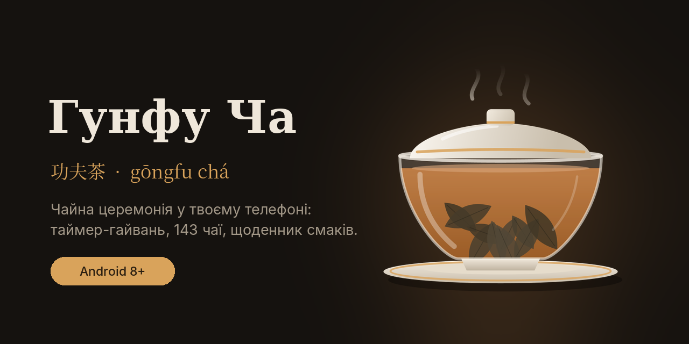
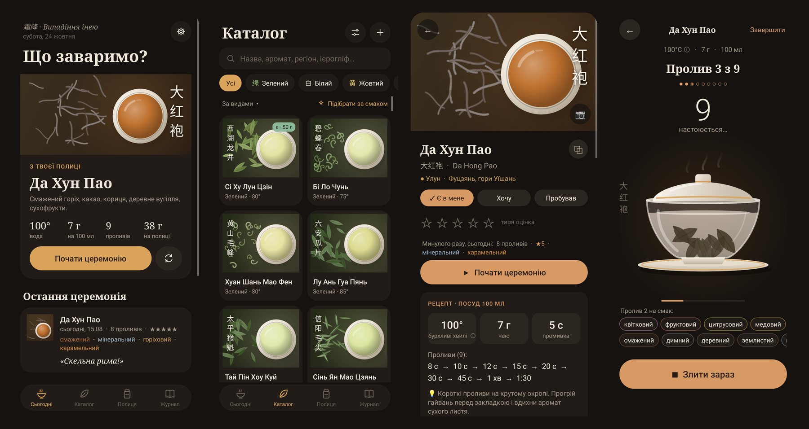
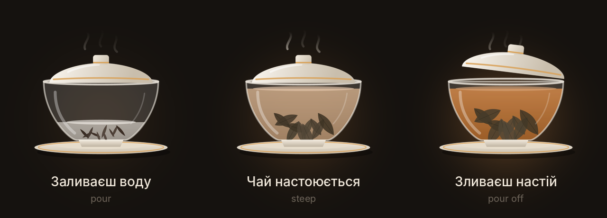
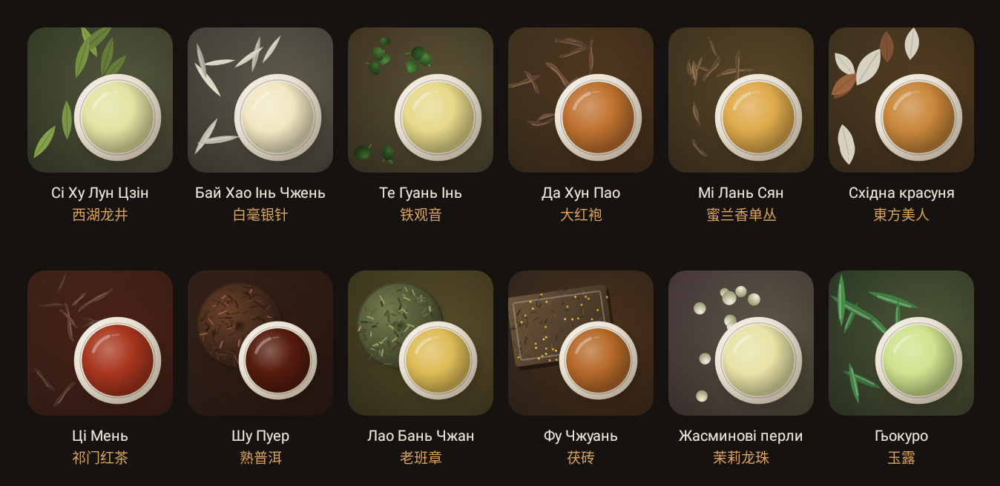
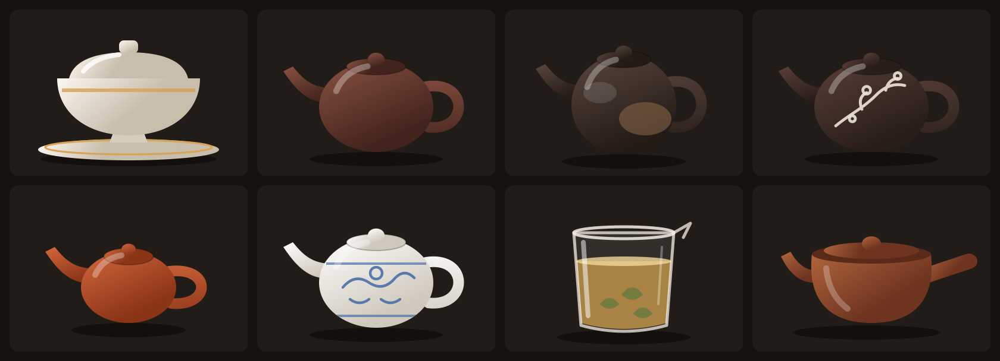
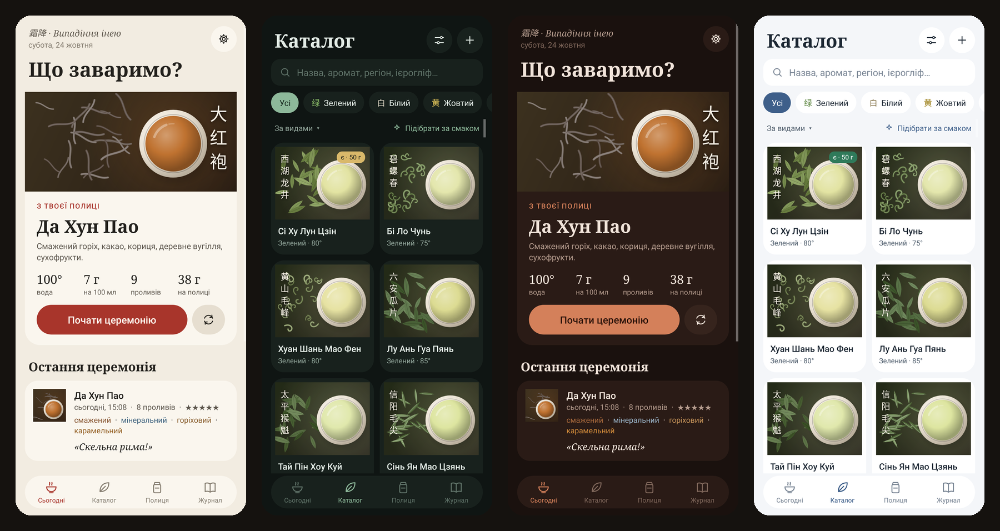

  

  <a href="https://github.com/golftennis3/gongfu-cha-releases/releases/latest"><b>⬇ Завантажити останню версію</b></a>
  &nbsp;·&nbsp;
  <a href="#english">English</a>

---

**Гунфу Ча** — тиха програма для китайської чайної церемонії 功夫茶. Вона веде тебе від першого проливу до останнього, підказує рецепт для кожного чаю і запам'ятовує, що ти відчував. Ніякої реклами, акаунтів чи зайвого шуму.

## Таймер-гайвань

Замість цифр — гайвань, яка повільно наповнюється настоєм: листя розкривається, з'являється пара, кришка піднімається, коли час зливати. Для кожного проливу свій час із рецепта. Між проливами — коротка пауза на три вдихи. Коли настій готовий, лунає звук: співоча чаша, дзвіночок, гонг, дерев'яна рибка або дзвоники вітру.

## 143 чаї

Зелені, білі, жовті, улуни, червоні, пуери з різних гір, темні чаї, а також Японія, Корея, Індія, Непал. Для кожного:
- рецепт для гунфу: температура, грами на об'єм, час кожного проливу;
- аромат, смак і традиційно описаний ефект;
- ієрогліфи, піньїнь, регіон.

Можна додати власний чай і власне фото.

## Щоденник смаків

- Під час церемонії відмічаєш смаки кожного проливу: квітковий, медовий, мінеральний…
- Журнал зберігає кожну церемонію: чай, проливи, грами, оцінку, нотатку.
- Статистика за місяць: що п'єш найчастіше, улюблені смаки, коли зазвичай чаюєш.
- Рекомендації: програма вчиться на твоїх смаках і підказує, що спробувати далі, і показує схожі чаї.
- Полиця з запасом у грамах (списується після церемонії) і список «Хочу спробувати».

## Чайний посуд

Довідник: гайвань, ісинська глина, нісін, цзяньшуй, чаочжоу, порцеляна, скло і кюсу — що це, як кожен змінює смак, для яких чаїв і як доглядати.

## Теми

Вечірня чайна, Рисовий папір, Нефрит, Ісинська глина, Синя порцеляна — або свій колір акценту. Можна ввімкнути «акцент — колір чаю»: сторінка кожного чаю набуває кольору його настою. І автоматичне перемикання: світла тема вдень, темна ввечері.

## І ще

- **Вода без термометра** — як на око визначити потрібну температуру за бульбашками.
- **Де купити** — пропозиції в наявності з Prom.ua, відсортовані за ціною за 100 г, і спеціалізовані українські чайні магазини.
- **Українська та англійська** — мову можна змінити в будь-який момент.
- **Резервна копія** — увесь журнал і полиця в одному файлі.

## Встановлення

1. Відкрий [останню версію](https://github.com/golftennis3/gongfu-cha-releases/releases/latest) з телефона й завантаж файл **GongfuCha-….apk**.
2. Відкрий його. Android попередить, що програма не з Google Play, — дозволь встановлення з цього джерела.
3. Готово. Далі **оновлення приходять самі**: коли виходить нова версія, у програмі з'явиться тихий рядок «Доступна версія…», одне натискання — і вона встановиться поверх, зі збереженням усіх даних.

Потрібен Android 8.0 або новіший.

## Приватність

Усе зберігається тільки на твоєму телефоні: жодних акаунтів, аналітики чи реклами. В інтернет програма звертається лише у двох випадках: коли ти відкриваєш «Де купити» (пошук на Prom.ua) і коли перевіряє, чи вийшла нова версія (цей репозиторій на GitHub).

Описи ефектів — традиційні враження чаювальників, а не медичні поради.

---

## English

**Gongfu Cha** is a quiet app for the Chinese tea ceremony 功夫茶. It guides you from the first infusion to the last, gives a recipe for every tea and remembers what you tasted. No ads, no accounts, no noise.

- **Gaiwan timer.** Instead of numbers, a gaiwan slowly fills with tea: the leaves unfurl, steam rises and the lid lifts when it's time to pour. Each infusion has its own time; between infusions, a short pause for three breaths. A singing bowl, bell, gong, wooden fish or wind chimes tells you when it's ready.
- **143 teas** — green, white, yellow, oolong, red, pu-erh from different mountains, dark teas, plus Japan, Korea, India and Nepal. Each with a gongfu recipe (temperature, grams, every infusion's time), aroma, taste, traditional effect, hanzi and pinyin. Add your own teas and photos.
- **Tasting journal.** Note flavours for each infusion; the journal keeps every ceremony. Monthly stats, taste-based recommendations, similar teas, a shelf with stock in grams and a wishlist.
- **Teaware guide** — gaiwan, Yixing, Nixing, Jianshui, Chaozhou, porcelain, glass and kyusu: how each shapes the taste, which teas suit it, how to care for it.
- **Water without a thermometer**, **where to buy** (in-stock offers from Ukrainian shops, by price per 100 g), **Ukrainian and English**, **backup to a file**.

**Install:** open the [latest release](https://github.com/golftennis3/gongfu-cha-releases/releases/latest) on your phone, download **GongfuCha-….apk**, open it and allow installing from this source. After that, updates arrive inside the app. Android 8.0 or newer.

**Privacy:** everything stays on your phone. The app only goes online to look up prices (Prom.ua) when you open “Where to buy”, and to check this repository for a new version.

---

Тут лише готові збірки програми. Особистий проєкт, не в Google Play. · Ready-made builds only. A personal project, not on Google Play.
